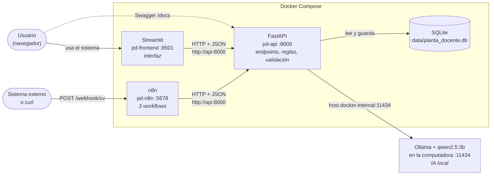

# Sistema Inteligente de Gestión de Planta Docente

TP2 — Elementos de Programación IA y LowCode · 2.º cuatrimestre 2026 · Proyecto B

## Objetivo

Organizar, consultar y analizar la planta docente de una institución educativa:

- **Alta de docentes** por formulario o **desde su CV**, con extracción de datos por IA y **revisión humana** obligatoria.
- **Asignación de materias** con reglas de negocio (tope de horas por dedicación, cobertura de cada materia, sin duplicados).
- **Indicadores** de la planta docente, **alertas de vencimiento** y **renovación** de designaciones.
- **Automatizaciones con n8n**: ingreso de CVs, avisos diarios de vencimientos y reporte semanal redactado por IA.

**Proceso principal:** CV → la IA extrae los datos → Python los valida → una persona revisa y confirma → se asignan materias → el sistema calcula indicadores y alertas → n8n automatiza avisos y reportes → una persona renueva las designaciones que vencen.

## Arquitectura



| Servicio | Tecnología | Puerto | URL |
|---|---|---|---|
| Interfaz | Streamlit | 8501 | http://localhost:8501 |
| API | FastAPI | 8000 | http://localhost:8000/docs (Swagger) |
| Automatizaciones | n8n | 5678 | http://localhost:5678 |
| IA | Ollama + `qwen2.5:3b` (en la computadora, fuera de Docker) | 11434 | http://localhost:11434 |
| Base de datos | SQLite | — | `data/planta_docente.db` |

Dentro de Docker Compose, Streamlit y n8n llaman a la API por su nombre de servicio (`http://api:8000`). La API llega a Ollama en `http://host.docker.internal:11434`. El detalle de componentes, capas y decisiones técnicas está en [`docs/arquitectura.md`](docs/arquitectura.md).

## Requisitos

- **Docker Desktop** (incluye Docker Compose). En Windows necesita WSL 2 (`wsl --install`) y la virtualización habilitada.
- **Ollama** instalado en la computadora: https://ollama.com/download
- Unos 3 GB libres para el modelo de IA.

## Instalación (una sola vez)

```bash
# 1. Clonar el repositorio
git clone https://github.com/12DFEXE/planta-docente-TP2.git
cd planta-docente-TP2

# 1b. Abrir Docker Desktop y esperar a que diga "Engine running"
#     (si está cerrado, docker compose falla con "failed to connect to the docker API")

# 2. Crear la configuración local (no se sube a Git). Sin este paso, docker compose falla con ".env not found"
cp .env.example .env            # en Windows (cmd): copy .env.example .env

# 3. Descargar el modelo de IA
ollama pull qwen2.5:3b

# 4. Construir e iniciar los servicios
docker compose up -d --build

# 5. Cargar datos de ejemplo (ficticios)
docker compose exec api python -m app.datos_ejemplo --reset

# 6. Importar los workflows en n8n
#    (antes, entrar a http://localhost:5678 y crear el usuario local de n8n)
docker compose exec n8n n8n import:workflow --separate --input=/workflows
```

Después, en n8n, abrir el workflow **1 - Ingreso de CV con IA** y hacer clic en **Publish** (arriba, en la barra del editor, o `Shift + P`) para que escuche el webhook. El estado tiene que quedar en *Published*. Los workflows 2 y 3 se pueden ejecutar a mano para la demo; solo hace falta publicarlos para que corran solos en su horario.

> n8n está fijado en la versión **2.46.6** (`compose.yaml`). En n8n 2.x el antiguo interruptor *Active* se reemplazó por el botón *Publish*.

> **Si la API no llega a Ollama** (`/ia/estado` devuelve `"disponible": false`): en Windows, crear la variable de entorno de usuario `OLLAMA_HOST=0.0.0.0` y reiniciar Ollama.

## Uso diario: iniciar, detener y reiniciar

```bash
docker compose up -d                 # iniciar todos los servicios
docker compose ps                    # ver el estado (los 3 deben decir "Up")
docker compose logs -f api           # ver los logs de un servicio (api, frontend o n8n)
docker compose restart               # reiniciar todos
docker compose restart api           # reiniciar uno solo
docker compose down                  # detener todo (los datos se conservan)
docker compose up -d --build api     # reconstruir la API si cambia requirements.txt
```

**Docker Desktop** y **Ollama** tienen que estar abiertos en la computadora (Ollama: ícono de la llama cerca del reloj).

**Modelo de IA:** se configura en `.env` con `OLLAMA_MODEL` (por defecto `qwen2.5:3b`). Se puede usar otro modelo descargado con Ollama poniendo su nombre exacto (como aparece en `ollama list`) y reiniciando la API con `docker compose up -d api`. Un modelo más grande puede superar el tiempo de espera (`OLLAMA_TIMEOUT`) en computadoras sin placa de video.

## Funcionalidades

**Interfaz (Streamlit)**

| Sección | Qué permite |
|---|---|
| Tablero | Indicadores, gráficos, materias sin cobertura, designaciones por vencer y reporte redactado por IA |
| Docentes | Listado con filtros, alta manual, **alta desde CV con IA** y edición / **confirmación de revisión humana** |
| Materias | Listado con su cobertura de horas y alta |
| Asignaciones | Listado, alta (las reglas las valida la API) y **renovación** de designaciones vencidas o por vencer |
| Notificaciones | Avisos generados por los workflows de n8n |

**API (FastAPI): 18 endpoints** — ver todos en http://localhost:8000/docs

| Grupo | Endpoints |
|---|---|
| Docentes | `POST /docentes`, `POST /docentes/cv`, `GET /docentes`, `GET /docentes/{id}`, `PUT /docentes/{id}` |
| Materias | `POST /materias`, `GET /materias` |
| Asignaciones | `POST /asignaciones`, `GET /asignaciones`, `PUT /asignaciones/{id}/renovar` |
| Indicadores y alertas | `GET /indicadores`, `GET /alertas/vencimientos` |
| IA | `GET /ia/estado`, `POST /reportes/resumen` |
| Notificaciones | `POST /notificaciones`, `GET /notificaciones`, `PUT /notificaciones/{id}/leida` |
| Sistema | `GET /health` |

Errores: **422** datos inválidos · **404** no existe · **409** regla de negocio o dato duplicado · **503** IA no disponible · **502** respuesta inválida de la IA.

**Reglas de negocio para asignar una materia:** el docente y la materia existen, el docente está activo (no pendiente de revisión), no está repetida, no supera las horas que necesita la materia y no supera el tope semanal por dedicación (simple 10 h, semiexclusiva 20 h, exclusiva 40 h).

**Reglas para renovar una designación:** la asignación existe, el docente sigue activo y la nueva fecha es posterior a hoy y al vencimiento actual.

## Inteligencia artificial

- **Modelo:** `qwen2.5:3b` corriendo localmente con **Ollama**.
- **Por qué:** es gratuito, no envía datos personales de los CVs a servicios externos, funciona sin internet, es liviano (anda sin placa de video), entiende español y responde en JSON.
- **Usos:** extraer datos de CVs, resumir el perfil del docente y redactar el reporte semanal.
- **Límites:** puede equivocarse o inventar datos y es lento en computadoras sin placa de video (1–2 minutos por CV).
- **Control:** lo que devuelve la IA se **valida y normaliza en Python**; si falta un dato obligatorio no se guarda nada; los docentes cargados por IA quedan **pendientes de revisión** hasta que una persona los confirma. Los indicadores se calculan **siempre con reglas**: la IA solo los redacta.

## Workflows de n8n

Exportados en [`n8n/workflows/`](n8n/workflows/). Cada uno llama a la API, tiene un nodo **IF** de decisión y deja el resultado en `POST /notificaciones`.

| Workflow | Disparador | Qué hace | Decisión |
|---|---|---|---|
| 1 - Ingreso de CV con IA | Webhook `POST /webhook/cv` | Envía el CV a `POST /docentes/cv` | ¿Se creó el docente? → aviso "pendiente de revisión" / "CV incompleto". Si la API falla → aviso de error |
| 2 - Alertas de vencimiento | Todos los días 8:00 (o manual) | Consulta `GET /alertas/vencimientos?dias=30` | ¿Hay designaciones por vencer? → aviso (urgente si alguna venció) / sin novedades |
| 3 - Reporte semanal con IA | Lunes 9:00 (o manual) | Pide `POST /reportes/resumen` | ¿Hay materias sin cobertura? → alerta prioritaria / reporte normal. Si la IA falla → aviso de error |

Enviar un CV al workflow 1:

```bash
curl -F "archivo=@data/ejemplos/cv_laura_martinez.txt" http://localhost:5678/webhook/cv
```

En **PowerShell** usar `curl.exe` (con `curl` solo se ejecuta otro comando que no acepta `-F`):

```powershell
curl.exe -F "archivo=@data/ejemplos/cv_laura_martinez.txt" http://localhost:5678/webhook/cv
```

Si se modifica un workflow en n8n, exportarlo antes de hacer commit:

```bash
docker compose exec n8n n8n export:workflow --all --separate --output=/workflows
```

## Verificación

```bash
docker compose exec api python -m app.verificacion     # 44 casos automáticos (correctos y de error)
```

Usa una base temporal y una IA simulada; la IA real y los workflows se verificaron a mano. Detalle y guion de la demo: [`docs/verificacion.md`](docs/verificacion.md).

## Estructura del repositorio

```
api/
  app/
    main.py            endpoints y manejo de errores HTTP
    schemas.py         modelos Pydantic (validación de datos)
    database.py        conexión y tablas SQLite
    errores.py         excepciones propias
    docentes.py        lógica de docentes
    materias.py        lógica de materias y cobertura
    asignaciones.py    reglas de negocio de asignaciones
    indicadores.py     indicadores y alertas de vencimiento
    notificaciones.py  avisos generados por n8n
    ia.py              conexión con Ollama
    cv.py              proceso de alta desde CV
    reportes.py        reporte: indicadores + texto de IA
    datos_ejemplo.py   carga de datos ficticios
    verificacion.py    verificación automática
  Dockerfile
  requirements.txt
frontend/
  app.py               punto de entrada: menú lateral, estado de API/IA y despacho a la página elegida
  comun.py             constantes y funciones compartidas por las páginas
  api_client.py        comunicación con la API y traducción de errores
  paginas/             una página por módulo, cada una con su función mostrar()
    tablero.py, docentes.py, materias.py, asignaciones.py, notificaciones.py
  Dockerfile
  requirements.txt
n8n/
  workflows/           workflows exportados (JSON)
  generar_workflows.py script con el que se generaron inicialmente
data/
  ejemplos/            CVs ficticios para la demo
docs/
  arquitectura.md      componentes, comunicación y decisiones técnicas
  verificacion.md      cómo se verificó y guion de la demo
  bitacora-ia.md       bitácora de uso de IA en el desarrollo
  guia-defensa.md      preguntas frecuentes para la defensa
compose.yaml
.env.example
```

## Integrantes y responsabilidades

| Integrante | Responsabilidades principales |
|---|---|
| **Exequiel Anaya** | API (endpoints, validaciones y reglas de negocio), integración de IA, verificación automática y datos de ejemplo, documentación |
| **Martín García** | Infraestructura con Docker Compose (versión fija de n8n, recarga del frontend en Windows), workflows de n8n, despliegue en servidor para la presentación, renovación de designaciones (endpoint, reglas, verificación y pantalla), modularización del frontend y menú de navegación, instalación y documentación para Windows |
| **Ambos** | Definición del alcance, interfaz Streamlit, pruebas integradas y bitácora de IA |

Los datos usados en el sistema son ficticios.
