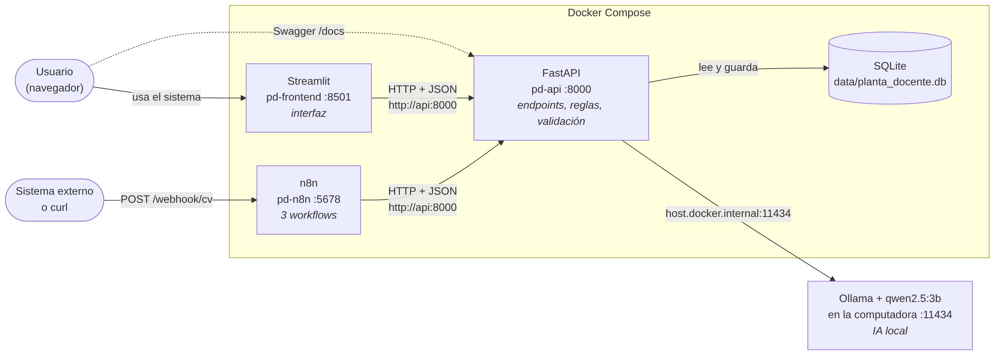

# Arquitectura y comunicación entre componentes



## Componentes

| Componente | Tecnología | Dónde corre | Puerto | Responsabilidad |
|---|---|---|---|---|
| **Interfaz** | Streamlit | Contenedor `pd-frontend` | 8501 | Formularios, tablas, tablero y notificaciones. **No tiene lógica de negocio**: todo lo pide a la API |
| **API** | FastAPI (Python) | Contenedor `pd-api` | 8000 | Endpoints, validación, reglas de negocio, cálculo de indicadores, integración con la IA |
| **Base de datos** | SQLite | Archivo `data/planta_docente.db` (volumen) | — | Docentes, materias, asignaciones y notificaciones |
| **Automatizaciones** | n8n | Contenedor `pd-n8n` | 5678 | 3 workflows: ingreso de CV, vencimientos y reporte semanal |
| **IA** | Ollama + `qwen2.5:3b` | En la computadora (fuera de Docker) | 11434 | Extraer datos de CVs, resumir perfiles y redactar el reporte |

## Comunicación

| Desde | Hacia | Cómo | Para qué |
|---|---|---|---|
| Navegador | Streamlit | `http://localhost:8501` | Usar el sistema |
| Navegador | API (Swagger) | `http://localhost:8000/docs` | Probar y documentar los endpoints |
| Navegador | n8n | `http://localhost:5678` | Ver y editar los workflows |
| Streamlit | API | `http://api:8000` (red interna de Docker) | Todas las operaciones, con JSON |
| n8n | API | `http://api:8000` (red interna de Docker) | Procesar CVs, consultar alertas, generar reportes y dejar notificaciones |
| Sistema externo / `curl` | n8n | `POST http://localhost:5678/webhook/cv` | Enviar un CV para que lo procese el workflow 1 |
| API | Ollama | `http://host.docker.internal:11434` | Pedirle a la IA que lea un CV o redacte un texto |
| API | SQLite | Archivo local (`sqlite3`) | Guardar y leer datos |

Dentro de Docker Compose, los contenedores se encuentran **por el nombre del servicio** (`api`, `frontend`, `n8n`). `host.docker.internal` es la dirección especial que permite a un contenedor llegar a un programa que corre en la computadora (Ollama).

## Capas dentro de la API

```
main.py          → endpoints (HTTP): recibe, deriva y traduce errores a códigos HTTP
schemas.py       → modelos Pydantic: valida la forma de los datos (422 si está mal)
docentes.py, materias.py, asignaciones.py, indicadores.py, notificaciones.py
                 → lógica de negocio: reglas y cálculos (lanza excepciones propias)
cv.py, reportes.py, ia.py
                 → integración con IA: la IA propone, Python valida
database.py      → persistencia en SQLite
errores.py       → excepciones propias (NoEncontrado → 404, Conflicto → 409, DatosInvalidos → 422)
```

## Organización de la interfaz (Streamlit)

```
app.py           → punto de entrada: configuración, menú lateral, estado de API e IA,
                   y despacho a la página elegida (diccionario PAGINAS → mostrar())
comun.py         → constantes (títulos, dedicaciones, etiquetas) y funciones compartidas
api_client.py    → única puerta hacia la API: hace las llamadas HTTP y traduce los errores
paginas/         → una página por módulo; cada una expone mostrar() y divide sus pestañas
                   en funciones (_listado, _alta, _renovar, ...)
```

Las páginas solo importan `api_client` y `comun`, nunca otra página: cada una se puede leer y modificar por separado. Para agregar una página se crea el módulo en `paginas/` y se suma una línea en `PAGINAS` (`app.py`).

## Recorrido de los datos: alta de un docente desde su CV

1. El usuario sube el CV en Streamlit (o un sistema lo envía al webhook de n8n).
2. La API lee el texto del archivo (.txt o .pdf) — `cv.py`.
3. La API le pide a Ollama que extraiga los datos en JSON — `ia.py`.
4. **Python valida y normaliza** lo que devolvió la IA (título, email, áreas, años) — `cv.py`.
5. Si falta un dato obligatorio → resultado *incompleto* y **no se guarda nada**.
6. Si está completo → se guarda como **pendiente de revisión**, con un resumen generado por IA.
7. Una persona revisa los datos en Streamlit y **confirma** → el docente pasa a *activo*.
8. Recién entonces se le pueden asignar materias (regla de negocio).

## Recorrido de los datos: vencimiento y renovación de una designación

1. Todos los días, el workflow 2 de n8n consulta `GET /alertas/vencimientos?dias=30`.
2. El nodo IF decide: si hay designaciones vencidas o por vencer, deja un aviso en `POST /notificaciones`.
3. La persona ve el aviso en Streamlit (barra lateral, Tablero y Notificaciones).
4. En **Asignaciones → Renovar designación** elige la designación y la nueva fecha.
5. La API valida las reglas (docente activo, fecha posterior a la actual) y guarda — `PUT /asignaciones/{id}/renovar`.
6. En la siguiente consulta, esa designación ya no aparece como alerta.

## Qué se calcula con reglas y qué hace la IA

| Con reglas (Python, resultado exacto) | Con IA (Ollama, resultado a revisar) |
|---|---|
| Validación de todos los datos de entrada | Extraer datos de un CV escrito en texto libre |
| Tope de horas por dedicación, duplicados, horas por materia | Resumen del perfil del docente |
| Indicadores: % de posgrado, cobertura, promedios | Redacción del reporte para la Dirección |
| Alertas de vencimiento | — |
| Normalización de lo que propone la IA | — |

## Decisiones técnicas

- **Docker Compose para todo el sistema**: se levanta con un comando y funciona igual en cualquier computadora.
- **Ollama fuera de Docker**: en un contenedor y sin placa de video es mucho más lento; la consigna permite correrlo localmente.
- **SQLite**: no requiere instalar un servidor; alcanza para un MVP y el archivo persiste en un volumen.
- **Notificaciones dentro del sistema** en vez de email: la demo no depende de credenciales ni de servicios externos.
- **Separación de capas**: la interfaz no conoce las reglas y la lógica no conoce HTTP. Así cada parte se puede cambiar o probar por separado.
